  
  
  

**Lusia** is a UI framework for [Bun](https://bun.sh). Each component lives in one `.lusia` file with its TypeScript, HTML and SCSS. Small, fast updates, with motion built in.

### The story

I wanted to call it *Lucia*, but that name was already taken on npm (╥﹏╥). So it became **Lusia**.

It started as a learning project, and I plan to keep supporting it. The goal is to make it as fast as possible.

Full honesty: most of the code is vibe-coded. The syntax is my design, though, so if something feels odd, that one is on me. Feedback is very welcome.

### Projects

| Repo | What it is |
|---|---|
| [lusia](https://github.com/lusiajs/lusia) | The framework |
| [create](https://github.com/lusiajs/create) | Start a Lusia app in one command |
| [docs](https://github.com/lusiajs/docs) | Guide, API and playground |
| [vsix](https://github.com/lusiajs/vsix) | Lusia support for VS Code |

### Support

If you enjoy Lusia and want to help, [sponsoring](https://github.com/sponsors/AzPepoze) lets me keep working on it. No pressure at all. A star or an issue helps too. Thank you!
